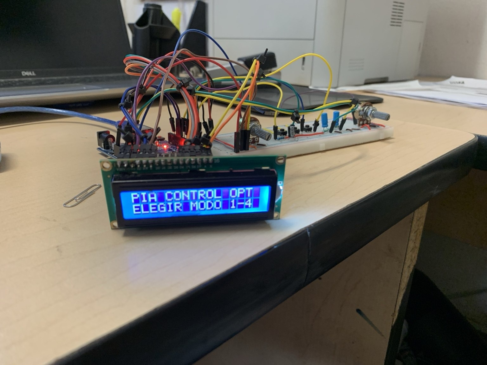
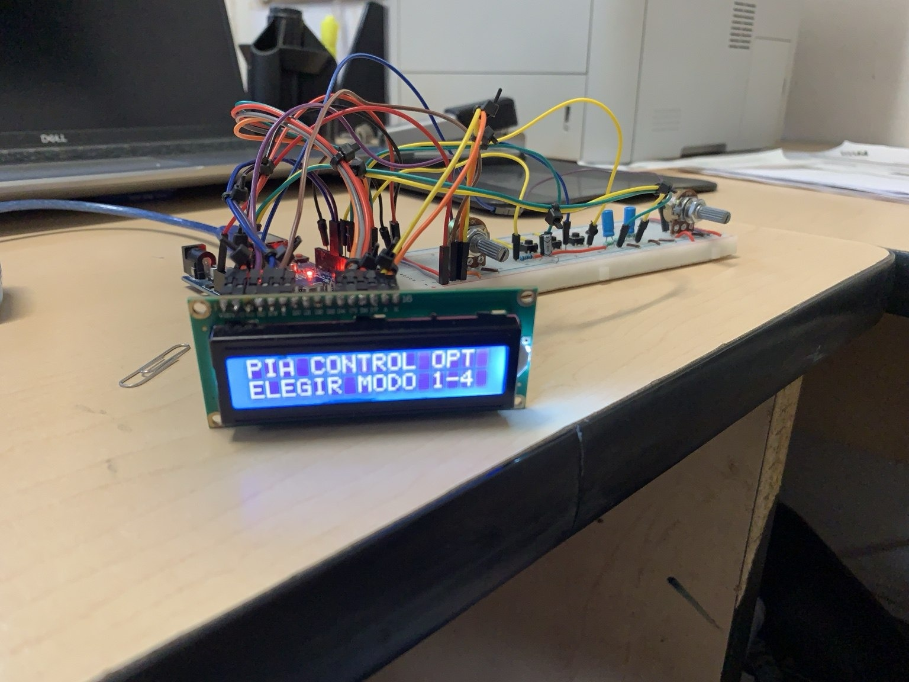
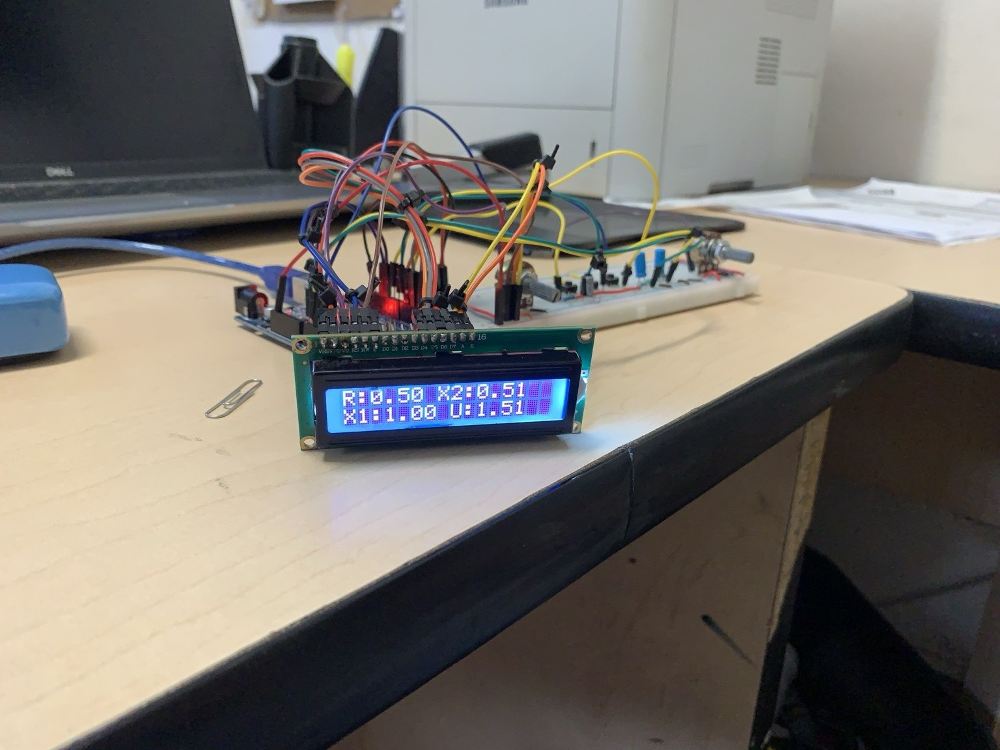
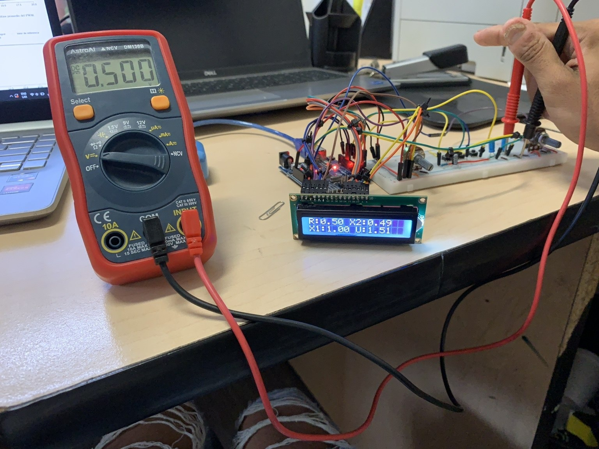
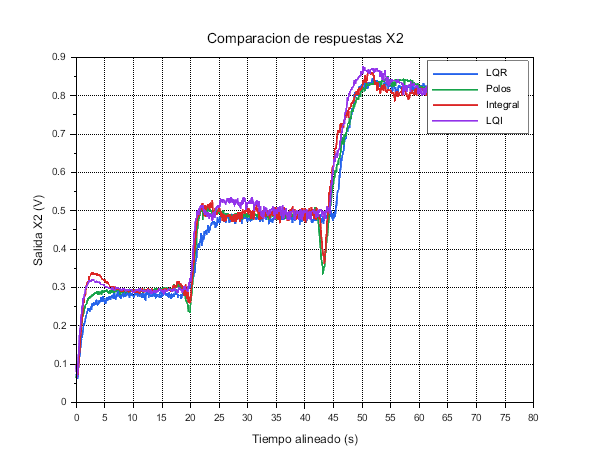
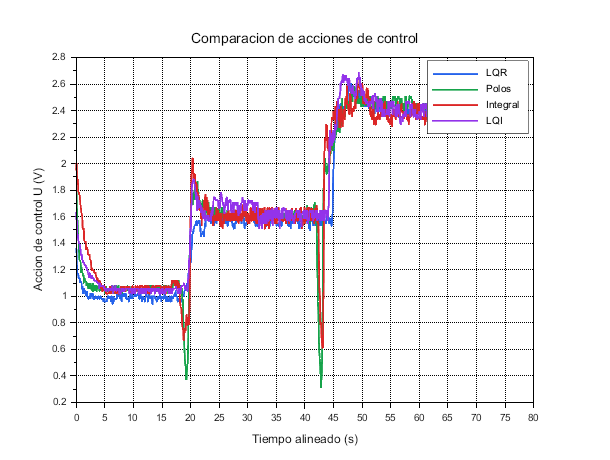
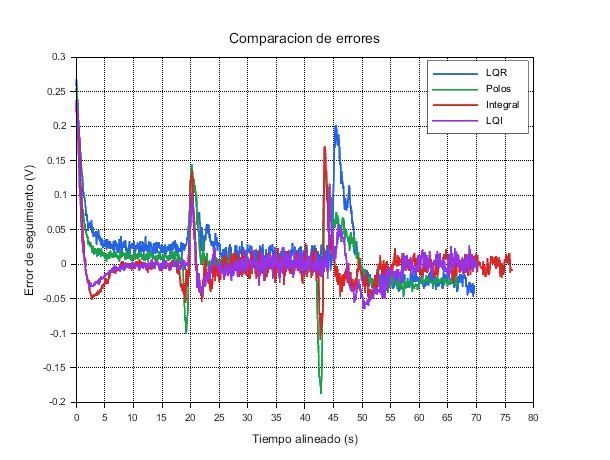
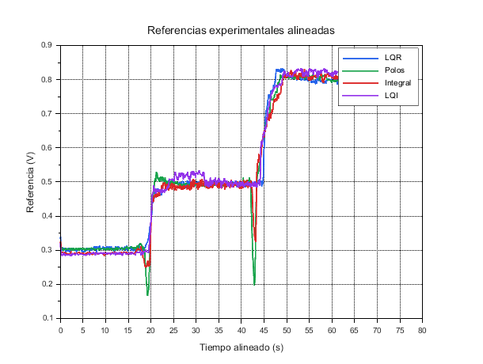

# PIA - Control Óptimo
## Implementación y comparación de controladores en una planta RC de segundo orden mediante Arduino UNO

**Universidad Autónoma de Nuevo León (UANL)**  
**Facultad de Ingeniería Mecánica y Eléctrica (FIME)**  
**Carrera:** Ingeniería en Electrónica y Automatización  
**Unidad de aprendizaje:** Control Óptimo  
**Periodo:** Agosto - Diciembre 2026  

**Alumno:** Marco Alexis Sánchez Hernández  
**Matrícula:** 1917797

---

## 1. Descripción del proyecto

El presente proyecto consiste en el diseño, simulación e implementación física de un sistema de control aplicado a una planta eléctrica RC de segundo orden.

La planta fue construida en protoboard utilizando resistencias y capacitores. Para realizar la adquisición de señales y ejecutar las leyes de control se utilizó un Arduino UNO, encargado de medir los estados del sistema y generar una señal PWM.

Se implementaron cuatro estrategias de control:

1. Control óptimo LQR.
2. Control mediante asignación de polos.
3. Control con acción integral.
4. Control óptimo LQI.

El comportamiento de los controladores se analizó mediante simulaciones en Scilab y pruebas experimentales realizadas sobre el circuito físico.

El propósito principal fue comparar la respuesta de cada controlador ante diferentes valores de referencia, evaluando el error de seguimiento, la acción de control y el comportamiento dinámico de la planta.

---

## 2. Objetivo general

Diseñar, implementar y evaluar diferentes estrategias de control para una planta RC de segundo orden, utilizando Arduino UNO como plataforma de adquisición y control, y Scilab como herramienta de simulación y análisis.

### Objetivos específicos

- Obtener el modelo matemático de la planta RC.
- Representar el sistema mediante ecuaciones de estado.
- Analizar la controlabilidad y observabilidad.
- Diseñar los controladores LQR, asignación de polos, integral y LQI.
- Implementar las leyes de control en Arduino UNO.
- Medir experimentalmente los estados de la planta.
- Registrar los resultados mediante comunicación serial.
- Comparar el desempeño de los cuatro controladores.

---

## 3. Descripción de la planta

La planta utilizada corresponde a un circuito RC de segundo orden.

El sistema cuenta con dos variables de estado:

- **X1:** voltaje del nodo intermedio.
- **X2:** voltaje de salida del circuito.

La señal de entrada es generada mediante PWM por el Arduino UNO.

### Componentes considerados en el modelo

| Componente | Valor |
|---|---|
| R1 | 1 MΩ |
| R2 | 1 MΩ |
| R3 | 1 MΩ |
| C1 | 1 µF |
| C2 | 1 µF |
| Resistencia del filtro PWM | 1 kΩ |
| Capacitor del filtro PWM | 10 µF |
| Microcontrolador | Arduino UNO |
| Pantalla | LCD 16x2 |

Los valores indicados corresponden al modelo y al programa documentados. Para reproducir el experimento deben verificarse con el montaje físico.

---

## 4. Modelo matemático

La representación del sistema en espacio de estados es:

$$
\dot{x}(t)=Ax(t)+Bu(t)
$$

$$
y(t)=Cx(t)
$$

Donde:

$$
A=
\begin{bmatrix}
-2 & 1\\
1 & -2
\end{bmatrix}
$$

$$
B=
\begin{bmatrix}
1\\
0
\end{bmatrix}
$$

$$
C=
\begin{bmatrix}
0 & 1
\end{bmatrix}
$$

Las ecuaciones diferenciales correspondientes son:

$$
\dot{x}_1=-2x_1+x_2+u
$$

$$
\dot{x}_2=x_1-2x_2
$$

La salida controlada corresponde a:

$$
y=x_2
$$

### Controlabilidad y observabilidad

Se evaluaron las matrices de controlabilidad y observabilidad del sistema.

Los resultados obtenidos fueron:

| Propiedad | Rango |
|---|---|
| Controlabilidad | 2 |
| Observabilidad | 2 |

Por lo tanto, el modelo es completamente controlable y observable.

---

## 5. Controladores implementados

### 5.1 Control LQR

El regulador lineal cuadrático busca determinar una ley de control que minimice un criterio de desempeño cuadrático.

La función de costo utilizada para el diseño considera las desviaciones de los estados y de la entrada respecto al equilibrio:

$$
J=\int_0^\infty
\left(
\tilde{x}^{T}Q\tilde{x}
+
\tilde{u}^{T}R\tilde{u}
\right)dt
$$

Con:

$$
Q=
\begin{bmatrix}
1&0\\
0&5
\end{bmatrix}
$$

$$
R=1
$$

La ganancia implementada es:

$$
K_{LQR}=
\begin{bmatrix}
0.41421356&0.41421356
\end{bmatrix}
$$

### 5.2 Asignación de polos

Este controlador permite modificar la ubicación de los polos del sistema en lazo cerrado mediante realimentación de estados.

La ganancia utilizada es:

$$
K_P=
\begin{bmatrix}
1&1
\end{bmatrix}
$$

### 5.3 Control con acción integral

Se incorpora una acción integral para reducir el error de seguimiento de referencia.

Las ganancias implementadas son:

$$
K_I=
\begin{bmatrix}
0.8&2.35
\end{bmatrix}
$$

$$
k_i=3
$$

### 5.4 Control LQI

El controlador LQI combina la realimentación óptima de estados con una acción integral del error.

Las ganancias implementadas son:

$$
K_{LQI}=
\begin{bmatrix}
0.71101988&1.17481439
\end{bmatrix}
$$

$$
k_i=1.41421356
$$

### Comparación de ganancias

| Controlador | K1 | K2 | Ki |
|---|---:|---:|---:|
| LQR | 0.4142 | 0.4142 | 0 |
| Polos | 1.0000 | 1.0000 | 0 |
| Integral | 0.8000 | 2.3500 | 3.0000 |
| LQI | 0.7110 | 1.1748 | 1.4142 |

---

## 6. Implementación con Arduino UNO

Para la implementación experimental se utilizó un Arduino UNO conectado a la planta RC.

El microcontrolador realiza las siguientes funciones:

1. Adquiere los voltajes X1 y X2.
2. Lee la referencia mediante un potenciómetro.
3. Calcula la acción de control.
4. Genera una señal PWM.
5. Muestra las variables en una pantalla LCD.
6. Envía los datos experimentales por comunicación serial.

### Conexiones principales

| Elemento | Pin Arduino |
|---|---|
| Salida PWM | D5 |
| Estado X1 | A0 |
| Estado X2 | A1 |
| Referencia | A2 |
| Botón START | D7 |
| Botón STOP | D8 |
| Botón RESET | D9 |

### Conexiones de la pantalla LCD

| LCD | Arduino |
|---|---|
| RS | D12 |
| E | D11 |
| D4 | D6 |
| D5 | D4 |
| D6 | D3 |
| D7 | D2 |

La tierra del circuito RC y la del Arduino deben estar conectadas en común.

### Ley de control

Para una referencia constante, se utilizan los valores de equilibrio:

$$
x_{1,eq}=2r
$$

$$
x_{2,eq}=r
$$

$$
u_{eq}=3r
$$

La ley de control implementada es:

$$
u=3r-k_1(x_1-2r)-k_2(x_2-r)+k_i I
$$

Donde:

$$
I(t)=\int_0^t(r-x_2)\,d\tau
$$

La acción de control se limita al intervalo de 0 a 5 V y se convierte en una señal PWM de 0 a 255.

---

## 7. Evidencia fotográfica del prototipo

Las siguientes fotografías corresponden a la implementación física del sistema de control.

### 7.1 Montaje completo



**Figura 1.** Montaje del sistema con Arduino UNO, protoboard y componentes electrónicos.

### 7.2 Circuito RC de segundo orden



**Figura 2.** Implementación física de la planta RC de segundo orden.

### 7.3 Pantalla LCD funcionando



**Figura 3.** Visualización de las variables de operación mediante la pantalla LCD.

### 7.4 Implementación experimental



**Figura 4.** Evidencia del prototipo utilizado durante las pruebas experimentales.

---

## 8. Adquisición de datos experimentales

El programa de Arduino permite registrar las variables del sistema mediante comunicación serial.

### Configuración

- Velocidad de comunicación: 115200 baudios.
- Período nominal de muestreo: 20 ms.
- Resolución PWM: 8 bits.
- Referencia de trabajo: 0 a 1 V.

### Formato CSV

Los registros experimentales utilizan el siguiente encabezado:

```csv
t_ms,modo,r,x1,x2,u,pwm
```

Donde:

| Variable | Descripción |
|---|---|
| t_ms | Tiempo en milisegundos |
| modo | Controlador seleccionado |
| r | Referencia |
| x1 | Estado intermedio |
| x2 | Salida de la planta |
| u | Acción de control |
| pwm | Valor PWM |

### Comandos disponibles

| Comando | Función |
|---|---|
| 1 | Seleccionar LQR |
| 2 | Seleccionar polos |
| 3 | Seleccionar integral |
| 4 | Seleccionar LQI |
| s | Iniciar sistema |
| x | Detener sistema |
| z | Reiniciar sistema |
| p | Visualización PLOT |
| c | Registro CSV |

---

## 9. Pruebas experimentales

Se realizaron pruebas de seguimiento de referencia con los cuatro controladores.

Las referencias utilizadas fueron:

- 0.30 V
- 0.50 V
- 0.80 V

Para cada controlador se analizaron:

- Respuesta de salida X2.
- Acción de control U.
- Error de seguimiento.
- Comportamiento de los estados.
- Indicadores de desempeño experimental.

Los registros se procesaron mediante Scilab para generar gráficas individuales y comparativas.

---

## 10. Resultados experimentales

Se calcularon indicadores para evaluar el desempeño de cada estrategia de control.

### Error absoluto medio (MAE)

| Controlador | 0.30 V | 0.50 V | 0.80 V |
|---|---:|---:|---:|
| LQR | 0.0505 | 0.0342 | 0.0443 |
| Polos | 0.0326 | 0.0219 | 0.0308 |
| Integral | 0.0244 | 0.0212 | 0.0151 |
| LQI | 0.0276 | 0.0214 | 0.0275 |

### Raíz del error cuadrático medio (RMSE)

| Controlador | 0.30 V | 0.50 V | 0.80 V |
|---|---:|---:|---:|
| LQR | 0.0713 | 0.0438 | 0.0638 |
| Polos | 0.0579 | 0.0442 | 0.0339 |
| Integral | 0.0496 | 0.0344 | 0.0196 |
| LQI | 0.0529 | 0.0306 | 0.0328 |

### Error estacionario estimado

| Controlador | 0.30 V | 0.50 V | 0.80 V |
|---|---:|---:|---:|
| LQR | 0.0252 | 0.0163 | -0.0223 |
| Polos | 0.0121 | 0.0040 | -0.0305 |
| Integral | -0.0013 | 0.0001 | 0.0019 |
| LQI | -0.0035 | -0.0082 | -0.0014 |

Los indicadores se obtuvieron a partir de las señales experimentales procesadas en Scilab, utilizando ventanas de análisis y filtrado de mediana.

### Interpretación

De acuerdo con los resultados experimentales:

- El controlador integral presentó el menor MAE en las tres referencias evaluadas.
- Para una referencia de 0.50 V, el controlador LQI presentó el menor RMSE.
- Los controladores con acción integral mostraron errores estacionarios estimados pequeños.
- Las diferencias entre controladores dependen de las condiciones del montaje y del procesamiento de las mediciones.

Estos resultados corresponden a las pruebas realizadas sobre el prototipo y no deben interpretarse como una comparación universal de los métodos de control.

---


## 11. Gráficas comparativas de los controladores

Para evaluar el comportamiento experimental de la planta RC de segundo orden, se compararon los resultados de cuatro estrategias de control:

- LQR.
- Asignación de polos.
- Control integral.
- LQI.

Las señales fueron procesadas en Scilab, aplicando un filtrado de mediana y alineación temporal para facilitar la comparación de las pruebas experimentales.

### 11.1 Comparación de respuestas X2



**Figura 5.** Comparación de las respuestas experimentales de salida X2 para los cuatro controladores.

Esta gráfica permite observar el seguimiento de referencia y las diferencias en el comportamiento dinámico de cada controlador.

### 11.2 Comparación de acciones de control



**Figura 6.** Comparación de las acciones de control aplicadas a la planta RC.

Se muestra la evolución de la señal U generada por cada controlador durante las pruebas experimentales.

### 11.3 Comparación de errores de seguimiento



**Figura 7.** Comparación de los errores de seguimiento de los cuatro controladores.

El error se define como:

$$
e(t)=r(t)-x_2(t)
$$

Esta comparación permite analizar la diferencia entre la referencia deseada y la salida medida.

### 11.4 Referencias experimentales alineadas



**Figura 8.** Referencias experimentales alineadas para los cuatro controladores.

Esta gráfica permite verificar los valores de referencia utilizados y su alineación temporal durante el procesamiento de los registros.

### Análisis general

A partir de los indicadores experimentales calculados en Scilab, se identificaron diferencias en el desempeño de los cuatro controladores.

El controlador integral presentó el menor error absoluto medio (MAE) en las tres referencias analizadas. Por otra parte, el controlador LQI presentó el menor RMSE para la referencia de 0.50 V.

Los resultados muestran la importancia de comparar tanto el seguimiento de referencia como la acción de control y el comportamiento experimental de la planta.


## Índice de desempeño cuadrático experimental

Para comparar el comportamiento de los cuatro controladores, se calculó el índice de desempeño cuadrático utilizando los registros experimentales obtenidos mediante Arduino UNO.

La función de costo utilizada fue:

$$
J=\int_{t_0}^{t_0+15}
\left[
(x_1-2r)^2+
5(x_2-r)^2+
(u-3r)^2
\right]dt
$$

El cálculo se realizó en Scilab mediante integración trapezoidal, utilizando ventanas de 15 segundos por referencia y un filtro de mediana de 11 muestras.

### Resultados experimentales

| Controlador | J (0.30 V) | J (0.50 V) | J (0.80 V) |
|---|---:|---:|---:|
| LQR | **1.04599** | **0.98149** | 1.02471 |
| Asignación de polos | 1.28652 | 1.03305 | 0.71675 |
| Integral | 1.96003 | 1.00845 | **0.42347** |
| LQI | 1.45719 | 1.00288 | 0.64864 |

### Análisis de resultados

El controlador LQR presentó el menor costo experimental para las referencias de 0.30 V y 0.50 V.

Para la referencia de 0.80 V, el controlador integral obtuvo el menor costo, con un valor de J = 0.42347.

Los resultados muestran que el desempeño depende de la referencia y de las condiciones experimentales. El índice J considera las desviaciones de los estados y el esfuerzo de control, por lo que sus resultados pueden diferir de los indicadores MAE y RMSE.

Los valores corresponden a ventanas experimentales de duración finita y no representan el costo teórico de horizonte infinito del diseño LQR.

## 12. Herramientas utilizadas

### Hardware

- Arduino UNO.
- Protoboard.
- Resistencias y capacitores.
- Pantalla LCD 16x2.
- Potenciómetro.
- Pulsadores.
- Multímetro.
- Cables de conexión.

### Software

- Arduino IDE.
- Scilab.
- LaTeX / Overleaf.
- GitHub.

---

## 13. Organización del repositorio

El proyecto se encuentra organizado dentro de la carpeta principal:

`PIA_Control_Optimo/`

El material comprende el código del Arduino, los programas de Scilab, los datos experimentales, las gráficas, las fotografías del prototipo y el reporte técnico, según los archivos disponibles.

La documentación fotográfica se encuentra en:

`PIA_Control_Optimo/Fotografia/`

---

## 14. Video de demostración

Se incorporará un video donde se explique:

1. El objetivo del proyecto.
2. La planta RC construida.
3. Las conexiones del Arduino.
4. El funcionamiento de los cuatro controladores.
5. Los resultados obtenidos en Scilab.
6. Las conclusiones experimentales.

**Enlace del video:** pendiente de publicación.

---

## 15. Conclusiones

El desarrollo del proyecto permitió aplicar los conocimientos de modelado matemático, análisis de sistemas y diseño de controladores a una planta física de segundo orden.

La implementación mediante Arduino UNO permitió adquirir los estados de la planta y generar acciones de control mediante PWM, mientras que Scilab facilitó la simulación y el procesamiento de los registros experimentales.

La comparación de los cuatro controladores permitió identificar diferencias en el seguimiento de referencia y en los indicadores de desempeño.

Las pruebas mostraron que la acción integral contribuyó a reducir el error de seguimiento en el montaje experimental, aunque el comportamiento final también estuvo condicionado por las características del circuito, la adquisición de datos y la saturación de la señal de control.

---

## Autor

**Marco Alexis Sánchez Hernández**  
Matrícula: 1917797  
Ingeniería en Electrónica y Automatización  
Facultad de Ingeniería Mecánica y Eléctrica  
Universidad Autónoma de Nuevo León

**Periodo académico: Agosto - Diciembre 2026**

---

*Proyecto Integrador de Aprendizaje — Control Óptimo — FIME UANL.*
